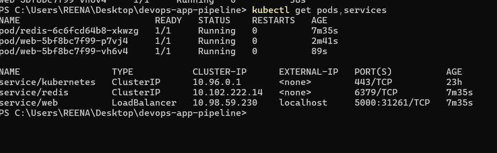

# devops-app-pipeline

A small Python web app taken step by step through a full DevOps workflow: Docker, CI/CD, Kubernetes and Terraform. Built to learn how the pieces fit together.

## Phase 1: Docker Compose (done)
A Flask web app counts page visits and stores the count in Redis. The app and the database run as two separate containers on one private network.

- `app.py`: the web app, with a `/health` endpoint
- `requirements.txt`: Python dependencies
- `Dockerfile`: builds the app image from a slim Python base
- `docker-compose.yml`: runs the app and Redis together; the app finds Redis by its service name

### Run it
You need Docker Desktop running. From this folder:

    docker compose up --build

Then open `localhost:5000`. Stop and remove everything with:

    docker compose down

### Result
[App running in Docker](app_running.png)

## Phase 2: CI/CD with GitHub Actions (done)
Every push to `main` triggers a GitHub Actions workflow that builds the Docker image and pushes it to Docker Hub.

- `.github/workflows/docker-publish.yml`: the pipeline
- Docker Hub credentials are stored as GitHub secrets (`DOCKERHUB_USERNAME`, `DOCKERHUB_TOKEN`), never in the code


Pull the image:

    docker pull shaik204/devops-app-pipeline:latest
## Phase 3: Kubernetes (done)

The same app now runs on a local Kubernetes cluster (Docker Desktop). The files are in the `k8s/` folder.

- `redis.yaml`: a Deployment and a Service for Redis. The Service is named `redis`, so the app finds it by name.
- `web.yaml`: a Deployment with 2 copies of the app (image from Docker Hub) and a LoadBalancer Service on port 5000.

Deploy:

```
kubectl apply -f k8s/
```

Open http://localhost:5000 and refresh to watch the visit counter go up.

Self-healing: when I deleted one web pod, Kubernetes created a new one automatically to keep 2 copies running.



## Phase 4: Terraform (done)

The AWS server is created from code. `terraform/main.tf` describes:

- a security group that allows only web traffic on port 80 (no SSH port is open)
- a t3.micro EC2 server whose startup script installs Docker and runs the Redis and web containers (image from Docker Hub)

Commands, run from the `terraform/` folder:

```
terraform init
terraform plan
terraform apply
terraform destroy
```

AWS keys are never stored in this repo. I passed them as environment variables in my own terminal for one session, then deleted the key. `.gitignore` keeps Terraform state files out of Git. After testing, `terraform destroy` removed everything so nothing keeps running.


## Roadmap
- Phase 1 (done): Docker Compose
- Phase 2 (done): GitHub Actions builds the image and pushes it to Docker Hub
- Phase 3 (done): Kubernetes on a local cluster
- Phase 4: create the AWS server with Terraform
  
## What I learned
Containers find each other by service name, and restarting the app does not lose data stored in a separate database container.

## Tools
Python, Flask, Redis, Docker, Docker Compose, GitHub Actions, Docker Hub, Kubernetes, Terraform, AWS EC2
